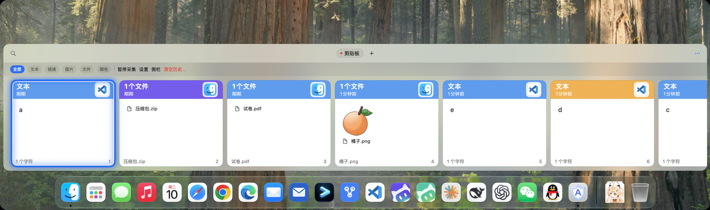
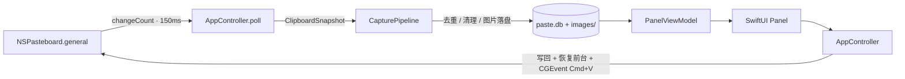

<div align="center">

# Paste

**一个只留在本机的 macOS 剪贴板历史管理器**

[](https://developer.apple.com/macos/)
[](https://swift.org)
[](#架构)
[](#测试与开发)
[](LICENSE)

原生 Swift · 零第三方依赖 · 不联网 · 不上传 · 键盘优先

</div>

---

复制过的文本、链接、颜色、图片和文件，Paste 都替你留着。一个快捷键呼出横向卡片带，选中即粘贴回**原来的应用**——不需要先切窗口，也不需要把数据交给任何云服务。



## 目录

- [特性](#特性)
- [快速开始](#快速开始)
- [环境版本](#环境版本)
- [使用](#使用)
- [设置](#设置)
- [架构](#架构)
- [数据与隐私](#数据与隐私)
- [权限与签名](#权限与签名)
- [测试与开发](#测试与开发)
- [已知限制与路线图](#已知限制与路线图)
- [常见问题](#常见问题)
- [贡献](#贡献)
- [许可证](#许可证)

## 特性

**采集**

- 文本、链接、颜色、图片（PNG / TIFF 转 PNG）、文件列表；按 `NSPasteboard.changeCount` 每 150ms 轮询
- 记录来源应用名称与图标；按可执行名排除密码管理器等应用
- 文本按内容跨类型去重；图片 / 文件按 SHA-256 内容哈希跨全历史去重；收藏板里的条目不参与去重
- 历史上限、按天保留期、清空历史（收藏板内容保留）；策略在设置变更后立即生效

**查找与粘贴**

- 三种搜索模式：普通（字面量，自动转义 `%` `_` `\`）、通配符（`*` / `?`，整串 GLOB 匹配）、正则（大小写不敏感，非法表达式返回空结果而不是报错）
- 收藏板（Pinboards）分组，`Cmd+P` 收藏到当前浏览的收藏板
- `Cmd+1..9` 不打开面板直接快速粘贴第 N 条历史（面板打开时则对应可见卡片）
- 粘贴时先恢复「打开面板前」的前台应用，再合成 `Cmd+V`；内容不可读或写入失败时中止，不会粘出旧剪贴板
- `Space` 查看全文：浮层自适应面板尺寸，长文本换行后可滚动、可选中复制；超长内容截断显示

**面板**

- `NSPanel` + SwiftUI + 原生 `NSVisualEffectView` 毛玻璃，圆角浮层
- 用 `NSScreen.visibleFrame` 定位，天然避开菜单栏与 Dock；多屏跟随光标所在屏
- 滚轮与方向键都用来切换选中卡片，选中卡片自动滚入视野
- 点击面板外或切换到别的应用自动收起
- 彩色标题条、相对时间、来源图标、棋盘格透明底缩略图、图片尺寸 / 字数、快速粘贴序号

**工程**

- 零第三方依赖：只用系统框架（SQLite3、ImageIO、Carbon、ApplicationServices、CryptoKit、AppKit、SwiftUI、ServiceManagement）
- 纯逻辑（数据层、分类、去重、几何、状态、格式化）与系统集成分层，76 个 XCTest 覆盖
- 单进程单一状态源：清空、删除、收藏写完立即刷新，所有视图保持一致
- 开机启动通过 `SMAppService` 接入系统登录项；注册失败会回滚设置并在设置窗口给出提示

## 快速开始

### 要求

| 项 | 要求 |
| --- | --- |
| 操作系统 | macOS 26.0+（`Package.swift` 部署目标） |
| 工具链 | Swift 6 / SwiftPM（Xcode 26+ 自带） |
| 架构 | Apple Silicon（已验证）；Intel Mac 未测试 |
| 权限 | 「辅助功能」授权（合成 `Cmd+V` 必需） |

### 构建与运行

```bash
git clone https://github.com/<owner>/paste.git && cd paste

swift build                    # 编译
swift test                     # 76 个单元测试
swift run PasteApp             # 直接运行（无 .app bundle，登录项开关不可用）

bash scripts/make-app.sh       # release 编译 + 组装 .app + ad-hoc 签名
open dist/Paste.app            # 启动（LSUIElement，只出现在菜单栏）
```

`make-app.sh` 会把 `AppIcon.icns` 放进 bundle、生成 `Info.plist`、执行 `codesign` 并校验签名。

两个不驻留的检查命令：

```bash
dist/Paste.app/Contents/MacOS/Paste --help         # 命令用法
dist/Paste.app/Contents/MacOS/Paste --self-check   # 数据目录、数据库、图标、设置、AX 状态
swift run paste-dbcheck                           # 只读解析 paste.db（兼容旧 schema）
swift run paste-dbcheck --db /path/to/other.db    # 指定数据库
```

## 环境版本

以下为**本地实际跑通**的环境（2026-11-10：`swift build`、`swift test`、`bash scripts/make-app.sh`、`--self-check`、`paste-dbcheck` 全部通过）：

| 项 | 版本 |
| --- | --- |
| macOS | 27.0.1（build 26A434） |
| 架构 | arm64 / Apple Silicon |
| Xcode | 27.1（27A9275） |
| Swift | 6.4（`swiftlang-6.4.0.34.1 clang-2100.3.34.1`） |
| Swift tools version | 6.0（`Package.swift`） |
| 部署目标 | macOS 26.0 |
| 测试结果 | 76 passed / 0 failed（PasteCore 25 + PasteAgent 51） |

最低可用版本见上节「要求」；低于 macOS 26 的系统缺少项目使用的 API，无法编译。

## 使用

| 快捷键 | 行为 |
| --- | --- |
| `Cmd+Shift+V` | 打开 / 收起面板（设置里可改） |
| `Enter` / `Cmd+Enter` | 粘贴选中项 / 强制按纯文本粘贴 |
| `←` `→` | 浏览卡片（选中卡片自动滚入视野） |
| `Space` | 查看全文内容 |
| `Del` | 删除选中项 |
| `Tab` | 循环切换类型筛选 |
| `Cmd+P` | 收藏 / 取消收藏 |
| `Cmd+B` | 显示 / 隐藏侧栏 |
| `Cmd+C` | 复制到剪贴板（不粘贴） |
| `/` 或任意字母数字 | 聚焦搜索框 |
| `Esc` | 清空搜索 → 关闭详情 → 隐藏面板 |
| `Cmd+1..9` | 快速粘贴第 1~9 条历史 |

- 鼠标滚轮（垂直或横向）与 `←` `→` 等效：滚动一格切换一张卡片；滚轮方向可在设置里反转。
- 菜单栏图标里还有「打开面板」「设置…」「暂停 / 恢复采集」「辅助功能」「退出」。全局快捷键被其它应用占用时，Carbon 注册失败只写日志，可从托盘继续操作。
- 卡片上的数字 1~9 与 `Cmd+数字` 一一对应。

## 设置

| 项 | 说明 |
| --- | --- |
| 全局快捷键 | 文本格式，如 `CmdOrCtrl+Shift+V`；保存前校验，格式错误不会注销正在用的热键 |
| 快速粘贴 | 是否注册 `Cmd+1..9` |
| 面板位置 | 顶部 / 居中 / 底部 |
| 搜索语法 | 普通 / 通配符 / 正则 |
| 滚轮方向 | 默认 / 自然 |
| 历史上限 | 0 = 不限；超出后删除最旧的未收藏项 |
| 自动删除天数 | 0 = 永久；只清理未收藏项 |
| 默认粘贴纯文本 | `Enter` 与 `Cmd+1..9` 都按纯文本粘贴（图片 / 文件自动忽略该选项） |
| 开机启动 | 通过 `SMAppService` 注册系统登录项；仅打包为 `.app` 后可用，`swift run` 下开关禁用；首次启用可能需要在系统设置中批准 |
| 排除应用 | 每行一个可执行名，默认内置常见密码管理器 |

## 架构



| 层 | 位置 | 职责 | 可测试性 |
| --- | --- | --- | --- |
| `PasteCore` | `Sources/PasteCore` | SQLite 数据层、模型、schema 与字段补齐 | 25 个 XCTest |
| `PasteAgent` | `Sources/PasteAgent` | 内容分类、去重策略、快捷键解析、面板几何与导航状态、文案格式化 | 51 个 XCTest |
| `PasteApp` | `Sources/PasteApp` | NSPanel、托盘、Carbon 热键、AX/CGEvent、SwiftUI 视图、登录项 | 自检 + 真机 |
| `PasteDiagnostics` | `Sources/PasteDiagnostics` | `paste-dbcheck` 只读诊断（兼容旧 schema） | 命令行 |

设计取舍：

- **能自动验证的逻辑全部放纯 Swift 层**，只有必须真机确认的系统集成留在 AppKit 层。
- **所有 SQL 使用匿名 `?` 顺序绑定**；批量清理在事务内，单条写入用单条 SQL（本身原子），不做字符串拼接。只读诊断不执行 DDL，缺列以常量代替。
- **自写剪贴板通过 `changeCount` 基线跳过重采集**，避免轮询竞态；写回前把全部数据备好并校验，内容缺失或路径失效时不会清空用户当前剪贴板。
- **设置 JSON 逐字段容错解码**：单个损坏字段、空字符串或旧版多余键都不会重置配置；整体损坏会记录日志。
- **缩略图、来源图标、图片尺寸均有界缓存**：清理删除图片时主动失效，缓存命中也校验文件存在，卡片刷新不会反复读盘。
- **合成按键的等待放到后台线程**，避免每次粘贴阻塞主线程约 90ms。

## 数据与隐私

- 数据目录：`~/Library/Application Support/com.pasteclone.app/`，含 `paste.db`（WAL）、`images/`、`icons/`。目录名沿用历史 bundle id，改动会丢失已有历史，因此保持不变。
- 三张表 `clips` / `pinboards` / `settings`；`clips.created_at` 是**毫秒**，`pinboards.created_at` 是**秒**。
- 设置是 `settings` 表中 `key='settings'` 的一条 JSON；缺字段按默认值补齐。
- 富文本 HTML 原样存储、原样写回 `public.html`（UTF-8 / UTF-16）；原生 UI 不渲染 HTML，因此不做清洗。若将来引入 WebView 渲染，必须先加隔离或清洗。
- 数据独立于应用本体存放，重装应用不会丢失历史、收藏板与设置。

> ⚠️ **剪贴板内容以明文保存在本机 SQLite。** 复制过的密码、令牌、私钥都可能进入历史。默认已排除常见密码管理器，请在设置里按自己的使用习惯补充排除应用，并避免把该目录同步到云盘。清空历史只删除未收藏项。

## 权限与签名

- 合成 `Cmd+V` 需要「系统设置 → 隐私与安全性 → 辅助功能」授权；未授权时跳过按键并记录日志。
- 开机启动由 macOS 登录项管理；ad-hoc 签名的 `.app` 首次启用可能需要在「系统设置 → 通用 → 登录项与扩展」中手动批准。
- `make-app.sh` 生成的是 **ad-hoc 签名**，仅本机可用；对外分发需 Developer ID 签名 + 公证。
- 每次重新打包后签名身份可能变化，若粘贴失效，重新勾选一次辅助功能。

## 测试与开发

```bash
swift test                     # 76 个单元测试，不需要真机权限
bash scripts/make-app.sh       # 打包 + 签名校验
```

覆盖：数据库 schema 逐字段读取、旧版数据库迁移与只读兼容、设置兼容与容错、三种搜索模式、去重与清理（含收藏项隔离与重复复制时清理）、Pinboard CRUD、面板几何（Dock 避让、多屏负坐标、短工作区夹取）、详情浮层尺寸与大文本截断、键盘导航、图片扩展名白名单、详情文本格式化、相对时间文案。

```
.
├── Package.swift
├── LICENSE
├── README.md
├── AppIcon.icns
├── snapshot.png
├── Sources/
│   ├── PasteCore/         # SQLite 数据层、模型、schema
│   ├── PasteAgent/        # 分类、去重、策略、快捷键解析、几何与状态
│   ├── PasteApp/          # AppKit / SwiftUI 集成、面板、托盘、热键、粘贴
│   └── PasteDiagnostics/  # paste-dbcheck 只读诊断
├── Tests/
│   ├── PasteCoreTests/
│   └── PasteAgentTests/
├── scripts/make-app.sh
└── dist/                  # 构建产物（已忽略）
```

## 已知限制与路线图

当前范围：

- 最低 macOS 26；仅在 Apple Silicon + macOS 27 上验证。
- 界面为中文，尚未做完整 i18n；外观跟随系统浅色 / 深色，暂不提供主题切换。
- 快捷键以文本形式输入并校验，尚未提供可视化录制器。
- 面板一次最多展示 500 条卡片，更早的历史仍保存在数据库且可被搜索到。
- 轮询是 `changeCount` 驱动的：极短时间内连续多次复制，中间的内容可能被跳过。
- 数据层在主线程同步执行；图片 / 图标缩略图在主线程按需生成，超大图片（>20MB）不生成缩略图。
- 全文预览最多显示前 100,000 个字符（超出会注明），避免超大文本一次性排版卡死面板。
- 富文本不清洗（见「数据与隐私」）。

计划中（欢迎 PR）：完整 i18n、快捷键录制 UI、主题与托盘图标自定义、收藏板拖拽排序、历史分页加载、可选加密存储。

## 常见问题

**按 `Cmd+Shift+V` 没反应？** 多半被编辑器或浏览器占用。查看日志 `[paste] could not register main hotkey`，或点菜单栏图标选择「打开面板」，也可在设置里换一个组合键。

**面板不自动收起？** 检查是否点在面板内部；全局鼠标监听依赖辅助功能权限，切换应用时另有前台应用通知兜底。

**粘贴没落到目标应用？** 检查辅助功能授权，以及目标 app 是否接受系统合成的按键事件；重新打包后可能要重新勾选一次授权。

**开机启动是灰的？** 只有打包为 `.app` 时 `SMAppService` 才能注册登录项；`swift run` 下该开关不可用。

**历史突然变少？** 检查设置里的「历史上限」与「自动删除天数」；清空历史会保留收藏板内容。

## 贡献

- 纯逻辑改动请放在 `PasteCore` / `PasteAgent` 并补上 XCTest；AppKit 侧改动请在 PR 里说明真机验证方式。
- 保持零第三方依赖与单进程单一状态源；SQL 一律使用参数绑定。
- 提交前跑 `swift test`，涉及打包时再跑一次 `bash scripts/make-app.sh`。
- 请勿在 issue / PR 里粘贴真实剪贴板内容、数据库文件或密钥。

## 许可证

[MIT](LICENSE) © 2026 Paste contributors
